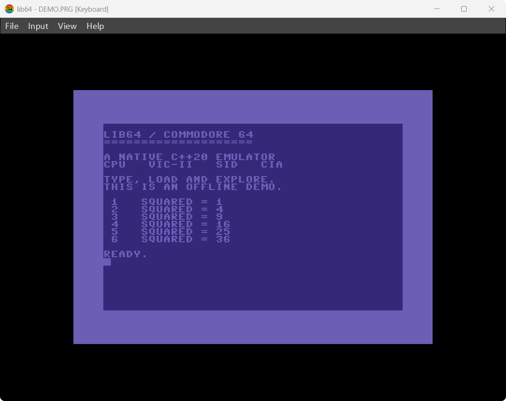

# lib64

[](https://github.com/ZacWalk/lib64/actions/workflows/build.yml)

A compact Commodore 64 emulator packaged as a C++20 static library, plus a small
Windows app built on the shared libdesktop platform layer.

The library is platform independent and does no file I/O — the host supplies
bytes, the library returns a frame buffer and audio samples. Diffractor embeds
it to play SID tunes and to run disks, tapes, cartridges and programs.



*An original BASIC sample running in the emulator.*

## What is emulated

| Chip | Coverage |
|------|----------|
| 6510 CPU | Every opcode, the undocumented ones included, and every addressing mode (including the indirect-`JMP` page-wrap bug), BCD arithmetic, `BRK`/`RTI`/`IRQ`/`NMI`, per-instruction cycle counts with page-crossing penalties |
| Memory | Full banking through the processor port at `$00`/`$01`, BASIC/KERNAL/character ROMs, the I/O area with its registers apart from the RAM beneath |
| VIC-II | 384×272 raster renderer: standard, multicolor and extended-colour text, standard and multicolor bitmap, 38-column and 24-row borders, 8 sprites with expansion, priority and collisions, raster interrupts, bad lines and sprite fetches taking the CPU's cycles, 16-colour VICE palette |
| SID | 6581/8580, three voices with ADSR envelopes, each chip's own filter, band-limited output at the host's sample rate; `.sid` (PSID/RSID) tunes, PAL or NTSC, play in an on-screen player |
| CIA ×2 | Timers, interrupts, time-of-day clocks with their alarms, the full keyboard matrix, two joysticks |
| Cartridge | `.crt` images in 8K, 16K and Ultimax modes, with bank switching for the common hardware types, EasyFlash among them |
| Disk | `.d64`/`.d71`/`.d81` mounted as device 8: the KERNAL LOAD routine is serviced from the image, so a program can keep loading files while it runs, and `LOAD"$",8` lists the directory |

Also included: starting a disk's file, a `.prg`, a `.p00` or a `.t64` tape's
file as a user would (`autostart_disk` types `LOAD"name",8,1` and `RUN` once
BASIC is ready), and a two-pass 6502 assembler.

Not emulated: the IEC serial bus, so a program that brings its own fastloader
gets no disk; SAVE, and reading a disk file through `OPEN`; and timing exact to
the cycle within an instruction, which some demos depend on.
[docs/design.md](docs/design.md) explains how each chip works and what it
leaves out.

## Build and run

The library and its test suite build on Windows with Visual Studio, x64 and
x86, and on Linux with GCC 13; the app is Windows-only. On Windows the vendored
[dd](https://github.com/ZacWalk/dd) driver, run from PowerShell 7.4+, locates
Visual Studio and uses the CMake and Ninja that ship with it:

```powershell
.\dd.ps1 build                  # both configurations
.\dd.ps1 test --label lib64   # build both, then run the suites below
.\dd.ps1 test --label headless # the same gate, no visible UI, real console check counts
.\dd.ps1 launch                 # build Release, then start the app
```

An unfiltered `.\dd.ps1 test` also starts the app to check that its window
opens and closes.

On Linux, with `g++`, `cmake` and `ninja-build` installed:

```bash
cmake --preset linux-release && cmake --build --preset linux-release
ctest --preset linux-release     # or pwsh ./dd.ps1 test, for both configurations
```

dd drives x64 only, so a 32-bit Windows build enters the x86 MSVC environment
itself:

```powershell
$vs = & "${env:ProgramFiles(x86)}\Microsoft Visual Studio\Installer\vswhere.exe" -latest -property installationPath
& $env:ComSpec /c "call `"$vs\VC\Auxiliary\Build\vcvarsall.bat`" x64_x86 >nul && cmake -S . -B build\x86-windows\release -G Ninja -DCMAKE_BUILD_TYPE=Release -DCMAKE_CXX_COMPILER=cl && cmake --build build\x86-windows\release && ctest --test-dir build\x86-windows\release"
```

Executables land in `bin/`: `app8bit64r.exe` (Release) and `app8bit64d.exe`
(Debug) for the app, `lib64_tests` and `lib64_testsd` (`.exe` on Windows)
for the suite. A 32-bit build names them `app8bit32*` and `lib64_tests32*`.
The library and the intermediates stay under `build/<platform>/<config>/`.

The app builds against the libdesktop revision pinned by `GIT_TAG` in
`CMakeLists.txt`, or against a sibling `..\libdesktop` checkout when there is
one.

### Host app icon

`python tools\generate_icon.py` regenerates `app\res\c64.ico`: vector C64
lettering over five horizontal rainbow bands that fill the circle.
The ICO contains nine desktop sizes. Add `--check` to verify without writing,
or `--output tmp\icon-128.png --size 128` for another size. The generator needs
only Python 3.9+'s standard library and the vendored `tools\iconlib.py`, not a
font, graphics package or sibling checkout.
`python tools\test_generate_icon.py` checks the stripe coverage and lettering.

## The app

Open a `.prg`, `.crt`, `.sid`, `.d64`, `.d71` or `.d81` through **File > Open**,
by dragging it onto the window, or by passing it on the command line. A file
with no extension is taken for a program; anything else is refused, leaving the
running machine alone. A disk image stays in the drive after its first program
starts, so games that load more data as they run work. A `.sid` tune comes up
in a player screen showing its details, a running clock, live per-voice level
meters and its sub-tunes: **1**-**9** pick a sub-tune and **X** stops playback.

Keys are mapped by position, as VICE maps them. The **Input** menu points the
arrow keys at the C64 cursor keys or at joystick port 1 or 2, and
**Help > Keyboard** lists the mapping and the shortcuts. The title bar states
the media, input mode, pause state and whether audio started. Window placement
and the debug panel's width and visibility are kept in
`%APPDATA%\lib64\lib64.ini`.

## Tests

`.\dd.ps1 test --label headless` (or `--label lib64`) runs, in both configurations:

- `lib64_tests`, the emulator suite. It prints a `PASS` or `FAIL` line per
  check, a total of the checks actually executed, and exits non-zero on any failure. Its fixtures are read from `test/`
  through the source path compiled in, so nothing needs copying next to the
  executable.
- On Windows, a check that the app embeds its application manifest, and the app
  itself with `-test`: an offscreen run of its layout, presentation, input,
  worker, settings and audio paths that never shows or focuses a window.

Presets show successful output too. After building,
`ctest --preset debug -L headless -V --no-tests=error` reruns without rebuilding
(`release` or `linux-release` as appropriate). Await direct GUI tests by piping:
`& .\bin\app8bit64r.exe -test 2>&1 | Out-Host; $LASTEXITCODE`.

The suite doubles as a small toolbox:

```powershell
.\bin\lib64_testsd.exe --list-disk .\test\1942.d64            # list a disk image
.\bin\lib64_testsd.exe --run-disk .\test\1942.d64 "1942*"     # mount, LOAD, RUN
.\bin\lib64_testsd.exe --run-prg .\test\example.prg           # boot, load, run a PRG
.\bin\lib64_testsd.exe --run-bin <file> <loadHex> <startHex>  # run a raw 6502 binary
.\bin\lib64_testsd.exe --asm <file.asm>                       # assemble 6502 source
.\bin\lib64_testsd.exe --render-sid <file.sid> <out.wav> [seconds] [song]  # render a tune
.\bin\lib64_testsd.exe --snap <file> <out.bmp> [seconds] [name]  # start it, save the picture
```

## Embedding

From CMake, bring this repository in with `add_subdirectory` or `FetchContent`
and link `lib64::lib64`: it then builds with the consumer's compiler,
configuration and C runtime, and builds neither the app nor the test suite. A
prebuilt library needs the same architecture, configuration and C runtime
library as its host.

Include `machine.h`, feed a `machine` bytes (`load_prg`, `load_crt`, `load_sid`,
`insert_disk`, or `autostart_disk` and `autostart_prg` to start one as a user
would), step it with `exec(cycles)`, then read `framebuffer()` and
`generate_audio()`, at the rate `set_audio_sample_rate` asks for. The header
documents every call, `app/app.cpp` is a complete worked host, and
[docs/design.md](docs/design.md) explains the execution model and the SID
monitor hooks.

## Licence

MIT; see [LICENSE](LICENSE). The C64 ROM images - `src/roms/` and the byte arrays
in `src/rom-chars.cpp`, `src/rom-kernal-basic.cpp` and `src/rom-kernal.cpp` - and
the programs, cartridges and tunes in `test/` belong to their copyright holders;
the licence does not cover them.

The app includes [libdesktop](https://github.com/ZacWalk/libdesktop), which is
licensed under the Mozilla Public License 2.0: anyone distributing the app must
tell its recipients where to get libdesktop's source code, including any changes
made to it. `tools/iconlib.py` is vendored from libdesktop under the same licence.

## Reference implementation

lib64 is a native port of [turbo8bit](https://github.com/ZacWalk/turbo8bit),
a Commodore 64 emulator in JavaScript.

Contributing, or working on this with an AI agent? See [AGENTS.md](AGENTS.md).
